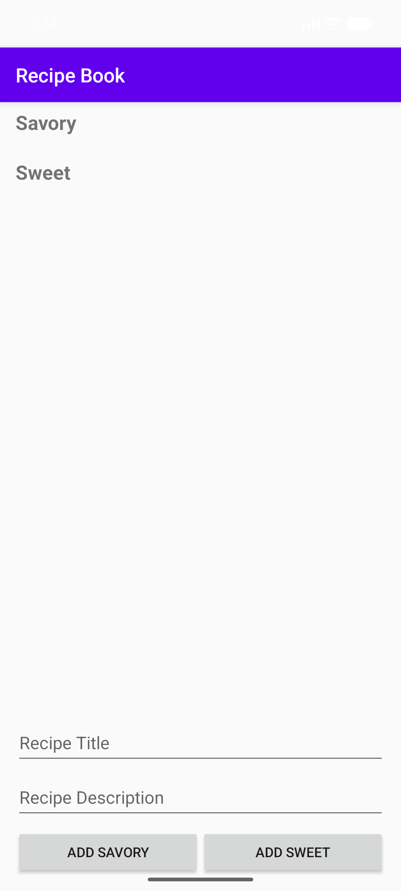
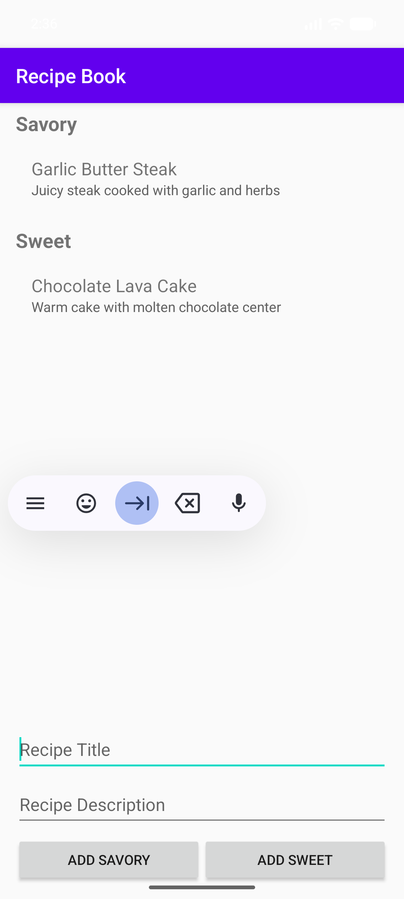
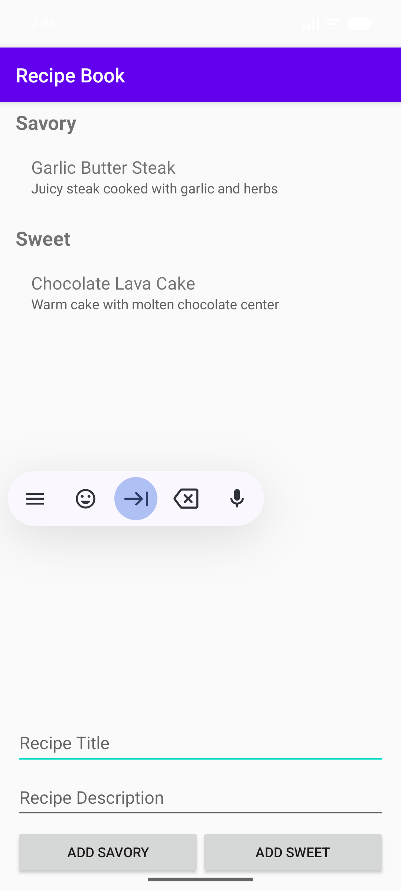

# Recipe Book

A small Android recipe manager that keeps sweet and savory recipes in one grouped list. Add recipes from the form at the bottom, tap a recipe to read its description, and swipe it away to delete it.

## Screenshots

| Empty state | Grouped recipes | Recipe details dialog |
| --- | --- | --- |
|  |  |  |

## Features

- Fixed **Savory** and **Sweet** flavor sections in a single scrolling list
- Add a recipe with a title and description using the matching flavor button
- Tap any recipe to open a dialog with its title and description
- Swipe a recipe left or right to delete it, with a red background and trash icon
- Blank title or description is rejected with a toast
- The form clears after a recipe is added
- Two-pane layout on tablets and other 600dp+ windows

## Tech stack

| Layer | Choice |
| --- | --- |
| Language | Kotlin |
| UI | XML layouts, RecyclerView, ConstraintLayout |
| App shell | AppCompatActivity + AppCompat DayNight theme |
| Interaction | AlertDialog, ItemTouchHelper |
| Build | Gradle 9.x, AGP 9.4.1, Kotlin 2.2.10 |
| SDK | minSdk 33, compileSdk/targetSdk 37 |

## Project structure

```text
app/src/main/java/com/example/recipemanagementapp/
├── MainActivity.kt                  # Wiring, add/delete logic, dialog
├── adapter/
│   ├── RecipeAdapter.kt             # Two view types: flavor header + recipe row
│   └── SwipeToDeleteCallback.kt     # Swipe background, icon, delete handling
└── model/
    ├── Flavor.kt                    # SAVORY, SWEET
    ├── Recipe.kt                    # title, description
    └── RecipeListItem.kt            # FlavorHeader / RecipeRow

app/src/main/res/
├── layout/activity_main.xml         # Phone layout
├── layout-sw600dp/activity_main.xml # Tablet two-pane layout
├── layout/item_flavor.xml           # Flavor header row
├── layout/item_recipe.xml           # Recipe row
└── drawable/ic_delete.xml           # Swipe-to-delete icon
```

## How it works

`MainActivity` keeps two in-memory lists, one per `Flavor`. `buildItems()` flattens them into a single list of `RecipeListItem`s: a `FlavorHeader` followed by its `RecipeRow`s. `RecipeAdapter` switches on the item type to inflate either `item_flavor.xml` or `item_recipe.xml`.

Recipe rows carry their `Flavor`, so `SwipeToDeleteCallback` knows which list to remove from when `onSwiped()` fires. The callback also blocks swiping on header rows and paints the red delete background while dragging.

On a 600dp+ window Android selects `layout-sw600dp/activity_main.xml`, which places the list and the add form side by side. Both layouts use the same view IDs, so no activity code changes are needed.

## Getting started

### Requirements

- Android Studio with Android SDK 37
- JDK 11 or newer
- An emulator or device running Android 13 (API 33) or newer

### Build and run

```bash
# Windows
gradlew.bat assembleDebug
gradlew.bat installDebug

# macOS / Linux
./gradlew assembleDebug
./gradlew installDebug
```

Or open the project in Android Studio and press **Run 'app'**.

## Usage

1. Type a title and description into the two fields.
2. Press **ADD SAVORY** or **ADD SWEET** to place the recipe in that section.
3. Tap a recipe to see its full description in a dialog.
4. Swipe a recipe left or right to delete it.

Recipes are stored in memory only; they reset when the app process restarts.
